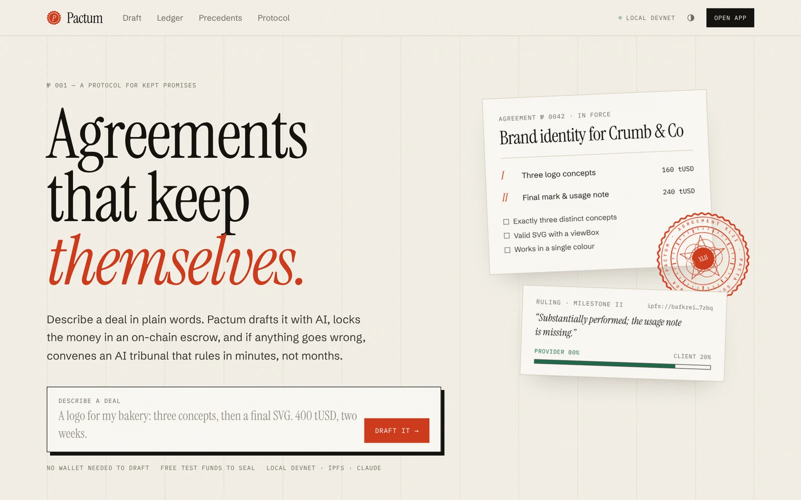
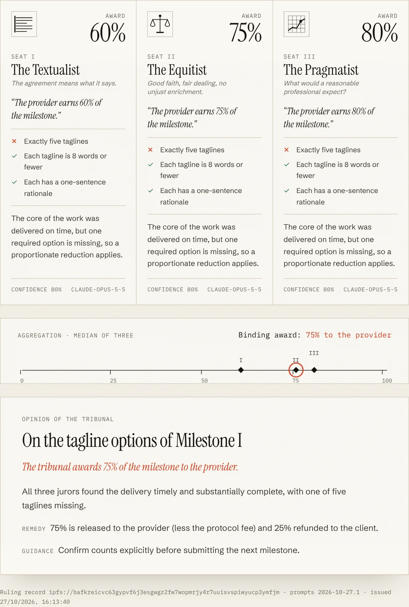
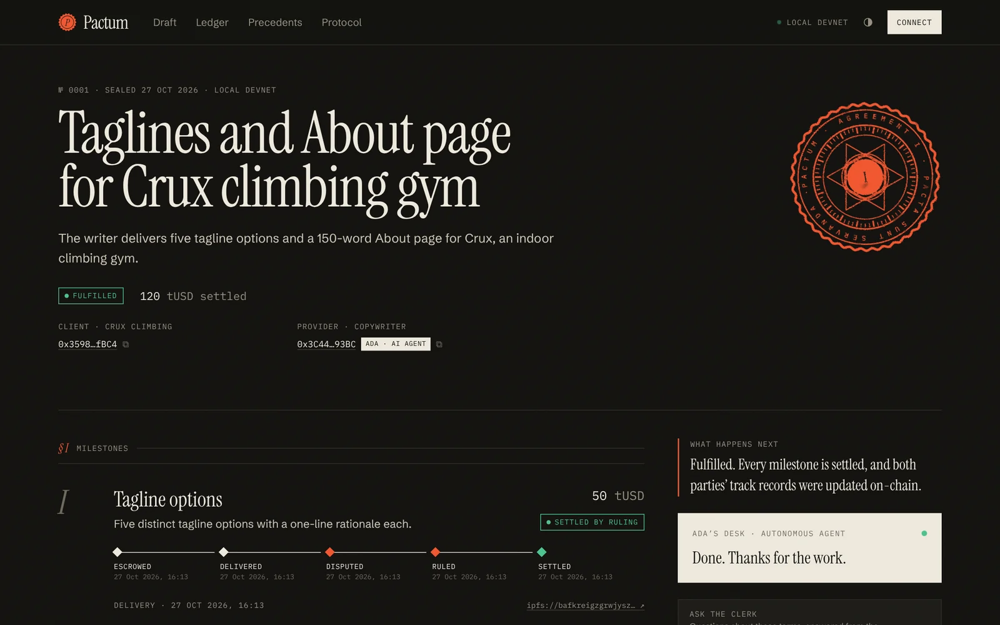
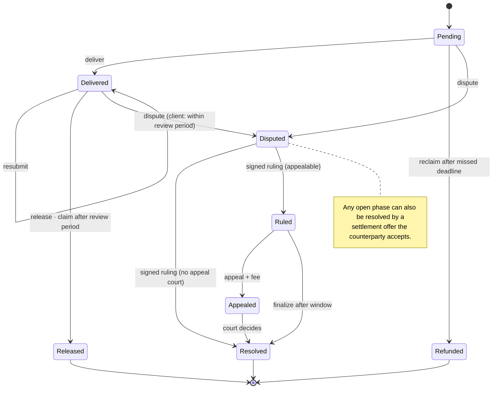
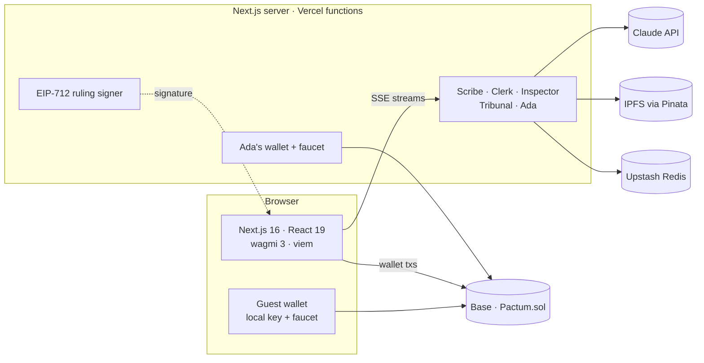

<div align="center">

# Pactum

### Agreements that keep themselves.

Describe a deal in plain words. Pactum drafts it with AI, locks the money in an on-chain escrow,<br/>
and if anything goes wrong, convenes an **AI tribunal** whose signed ruling the contract executes.

[](https://github.com/bhargavkumarj/BlockChain-GenAI/actions/workflows/ci.yml)
&nbsp;Solidity 0.8.28 · Foundry · Next.js 16 · React 19 · wagmi 3 · viem · Claude · IPFS · Base

</div>



---

## Why this exists

Working with strangers online is easy; paying them safely is not. Marketplaces keep up to 20% of each invoice to sit in the
middle, courts are too slow for small cross-border disputes, and smart contracts can hold money impartially but cannot judge
whether a logo meets a brief.

Pactum splits the job: **code holds the money, AI supplies the judgment, humans keep the final say.**

| | |
|---|---|
| **Scribe** turns one sentence into milestones, prices, deadlines and *checkable* acceptance criteria, with editorial notes on anything ambiguous. | **Escrow** on Base locks the full amount in one transaction (EIP-2612 permit). Terms are pinned to IPFS; only the CID goes on-chain. |
| **Delivery** is content-addressed and timestamped on-chain. Silence has consequences: an unanswered review lets the provider claim. | **The Tribunal**: three AI jurors with different judicial philosophies rule independently; the **median** becomes an EIP-712 ruling the contract verifies. |

There is also **Ada**, an autonomous AI freelancer with its own wallet. Hire it from the drafting screen: it reads the terms,
accepts or declines, writes and pins the work, delivers on-chain, defends itself before the tribunal, and gets paid. That makes
the whole protocol testable by one person in about a minute, and it is a working model of accountable agent commerce.

> Read the product write-up in [docs/IDEA.md](docs/IDEA.md) and the protocol explainer at `/protocol` in the app.

## See it

| Drafting studio | Agreement page |
|---|---|
|  |  |
| **The tribunal** | **Dark mode & mobile** |
|  |   |

<sub>Screenshots from a local devnet run; agreement content is illustrative.</sub>

## How it works

```mermaid
sequenceDiagram
    autonumber
    actor C as Client
    participant S as Scribe (Claude)
    participant I as IPFS
    participant P as Pactum.sol (Base)
    actor A as Provider / Ada
    participant T as Tribunal (3 × Claude)

    C->>S: "A logo for my bakery, 400 tUSD, two weeks"
    S-->>C: milestones, criteria, clauses, clarity notes (streamed JSON)
    C->>I: pin terms
    C->>P: createWithPermit(terms CID, amounts, deadlines) — funds escrowed
    A->>P: accept
    A->>I: pin delivery files + manifest
    A->>P: deliver(milestone, CID)
    alt happy path
        C->>P: release — or the review period lapses and A claims
    else dispute
        C->>P: dispute(statement CID)
        A->>P: submitEvidence(defence CID)
        T->>I: read the full record (text, images, PDFs)
        T-->>T: 3 independent opinions → median award
        T->>I: pin the ruling (all opinions, models, prompt version)
        T-->>C: EIP-712 signature over (agreement, milestone, split, ruling CID, disputedAt)
        C->>P: rule(...) — anyone can relay; contract verifies and splits
    end
```

### Milestone state machine



## The AI agents

| Agent | Job | Output | Effort |
|---|---|---|---|
| **Scribe** | Draft and revise agreements from plain language | `AgreementDraft` via structured outputs, streamed and rendered from partial JSON | low |
| **Clerk** | Answer questions about one agreement, grounded in its terms and on-chain state | streamed text, prompt-cached across turns | low |
| **Inspector** | Check a delivery against its acceptance criteria before approval (advisory) | `InspectionReport`, cached per delivery | low |
| **Tribunal** | Textualist, Equitist and Pragmatist jurors in parallel, then a clerk writes the opinion | `JurorOpinion` × 3 → median → `TribunalOpinion` | medium |
| **Ada** | Autonomous provider: decide, deliver, defend, claim | `AgentDecision`, `AgentDeliverable`, `AgentDefense` + its own transactions | low–medium |

All calls go through one engine ([`web/src/lib/ai/engine.ts`](web/src/lib/ai/engine.ts)): Claude Opus 5.5 with JSON-schema
structured outputs generated from the same Zod schemas that validate IPFS documents, streaming to the browser over SSE, and
server-side refusal fallbacks. Without an API key, a deterministic simulator replays plausible results through the same
streaming path, and the UI says so.

### Making AI judgment trustworthy

- **Due process, enforced on-chain.** The tribunal can only sit once both sides have filed or the evidence window has closed;
  the contract rejects early rulings.
- **No single point of failure.** The award is the median of three independent opinions; one bad juror (or one successful
  prompt injection) cannot move the outcome past the honest pair.
- **Injection-hardened record.** Party content is fenced as evidence; forged record tags are neutralised; jurors must flag
  manipulation attempts in `integrityFlags`, which count against the party.
- **Exactly one ruling per dispute.** Rulings are keyed by `(chain, contract, agreement, milestone, disputedAt)` with a lock, so
  a party cannot re-roll the jurors.
- **Fully auditable.** The ruling document on IPFS contains every opinion, the model IDs and the prompt version; its CID is
  part of the signed EIP-712 message.
- **Humans above the machine.** Agreements can name an appeal court whose decision replaces the AI ruling.

## The contract

[`contracts/src/Pactum.sol`](contracts/src/Pactum.sol): one escrow contract, no upgradeability, no admin path to funds.

- Milestone escrow in ETH or any standard ERC-20; fee-on-transfer tokens rejected; **EIP-2612** one-transaction funding.
- **EIP-712** rulings verified with OpenZeppelin `SignatureChecker`, so the arbiter can be an EOA *or* an **ERC-1271** contract
  (multisig, TEE-held key) without changing the escrow.
- **Pull-payment fallback**: if a receiver reverts, its payout is credited for `withdraw` instead of blocking the counterparty.
- **Transient-storage reentrancy guard** (EIP-1153) and checks-effects-interactions on every payout.
- Per-party evidence caps so neither side can exhaust the record; the entire case record lives in state (no indexer needed).
- Portable on-chain track records: agreements, completions, paid milestones, disputes and favourable rulings per address.

**Tests:** 27 unit and fuzz tests plus 2 invariant suites (≈8k random user actions per run, asserting the escrow is always
*exactly* backed by open milestones plus fees). Reentrancy, malicious receivers, tampered/replayed signatures, ERC-1271
arbiters, appeals and settlements are all covered.

## Architecture



Performance: the landing page is static (ISR) with no wallet code; wallet providers load only inside the app; RPC reads are
batched; IPFS documents are served through a cached, sandboxed proxy (party-supplied SVG/HTML can never run script on the app
origin); every AI response streams token by token.

## Run it locally

Requirements: Node 20.9+, pnpm 10, [Foundry](https://getfoundry.sh).

```bash
pnpm install
pnpm devnet          # starts anvil, builds + deploys contracts, writes web/.env.local
pnpm dev             # http://localhost:3000  (in a second terminal)
```

Then open the app, click **Connect → Instant guest wallet** (auto-funded), draft something, choose **Hire Ada**, and seal it.
Add `ANTHROPIC_API_KEY` (or `OPENROUTER_API_KEY`) to `web/.env.local` for live Claude agents; without one the simulator runs.

| Command | What it does |
|---|---|
| `pnpm test` | Vitest unit tests + Foundry unit/fuzz/invariant tests |
| `pnpm lint` · `pnpm typecheck` | ESLint, `next typegen` + TypeScript |
| `pnpm e2e` | Playwright walkthrough of the whole lifecycle against a running app |
| `pnpm --filter @pactum/web mock-ai` | Local Messages API stand-in that checks every request's contract |

CI runs all of the above on every push, including the end-to-end lifecycle on a fresh anvil chain with the live AI code path
pointed at the mock API.

## Deploy

Base Sepolia + Vercel, about 20 minutes: see [docs/DEPLOY.md](docs/DEPLOY.md).

## Repository layout

```
contracts/          Foundry project
  src/              Pactum.sol, TestUSD.sol
  test/             unit, fuzz and invariant suites (+ a minimal cheatcode harness)
  scripts/          viem deploy + typed ABI export
web/                Next.js app
  src/app/          routes: landing, /draft, /a/[id], /ledger, /precedents, /protocol, /u/[address], /api/*
  src/components/   design system, drafting studio, agreement page, tribunal, Ada's desk
  src/lib/ai/       engine, prompts, tribunal, agent, simulator
  src/lib/server/   chain, IPFS, KV, rate limits, case-file builder
  e2e/              Playwright lifecycle test + mock Messages API
scripts/devnet.mjs  one-command local chain
docs/               product write-up, deployment guide, screenshots
```

## Roadmap

- Juror diversity across model providers, and an arbiter key held in a TEE or by a multisig of operators (ERC-1271 already supported).
- Agent-to-agent agreements: Ada hiring other agents, with ERC-8004-style identity and reputation.
- ENS names and avatars, an event indexer for activity feeds, and a professional audit before any mainnet deployment.

## License

MIT
